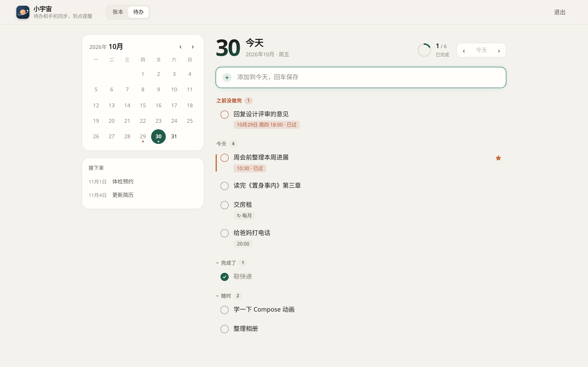
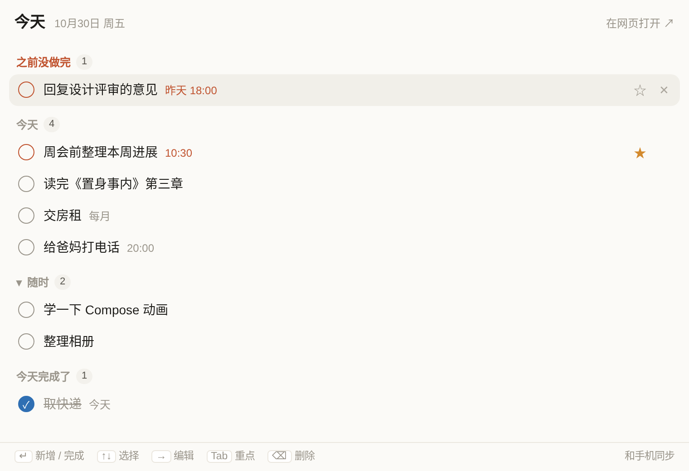
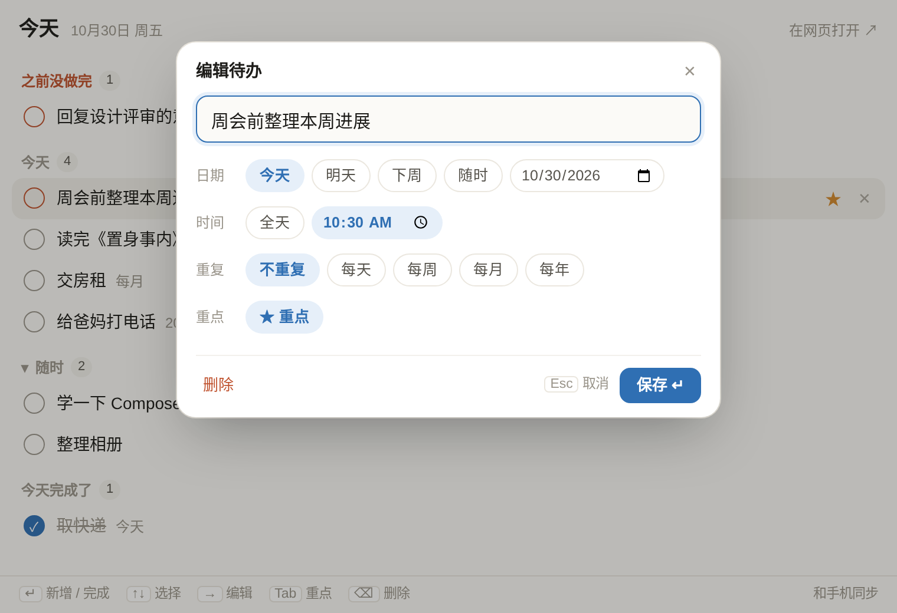
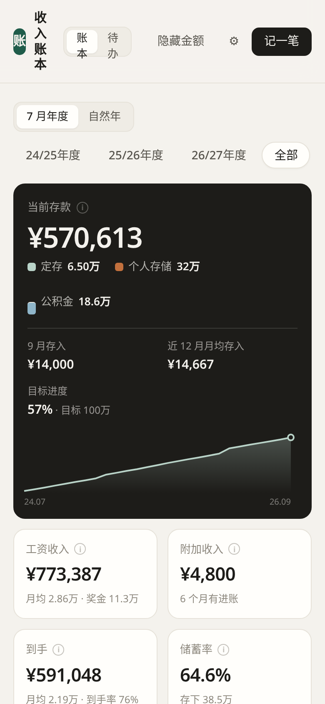
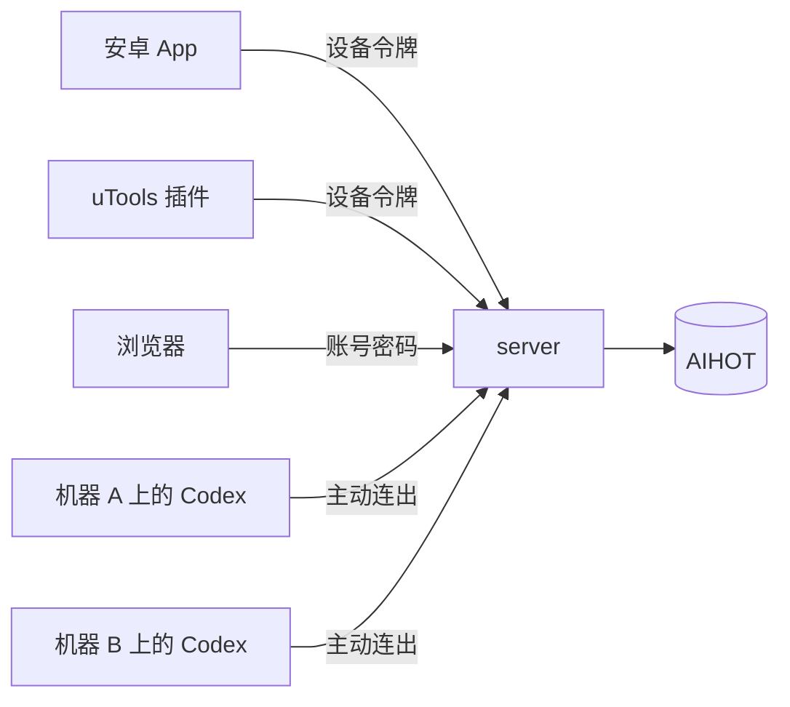

<p align="center"></p>

<h1 align="center">小宇宙</h1>

<p align="center">一个只给自己用的个人助手：一台服务器 + 一个安卓 App + 网页版 + uTools 插件。</p>

---

把每天要看、要做的事收到一个入口里：早上刷资讯，白天记待办，离开电脑时在手机上盯着 Codex 跑任务，月底记一笔储蓄。数据只有一份，存在你自己的服务器上。


## 有什么

| 模块 | 能做什么 | 在哪用 |
|---|---|---|
| 资讯 | AI 日报和热榜（数据来自 [AIHOT](https://github.com/KKKKhazix/AIHOT)），App 内直接排版阅读正文 | App |
| Codex | 查看各台机器上正在跑的 Codex 会话，发消息、语音输入、发图片、批准或拒绝操作、停止、新开会话；跑完或等你处理时提醒 | App |
| 待办 | 今天的待办、日历按天查看、重复（每天/周/月/年）、重点、到点提醒（手机本地闹钟） | App、网页、uTools |
| 备忘 | 随手记，和待办分开 | App |
| 储蓄 | 按月记工资、奖金、五险一金和存款去向；看存款、储蓄率、年度对比、目标进度；指纹解锁 | App、网页 |

## 截图

> 截图里的数据都是生成的演示数据。

**待办网页版**：左边日历，右边按天看，回车就加；键盘就能操作完。



**uTools 插件**：快捷键呼出，回车加到今天，点文字就能编辑，跟随系统深浅色。

<table>
  <tr>
    <td></td>
    <td></td>
  </tr>
</table>

**深色模式和手机浏览器**

<table>
  <tr>
    <td width="72%"></td>
    <td></td>
  </tr>
</table>

## 结构

```
server/    Node 后端（单进程，JSON 文件存储，唯一依赖 ws）
web/       网页版：储蓄分析 + 待办（React + Vite）
android/   安卓 App（Kotlin + Jetpack Compose）
utools/    uTools 待办插件：快捷键呼出、回车加到今天、编辑
scripts/   发版、机器接入脚本
docs/adr/  设计决策记录
```



几个取舍，详细理由见 [docs/adr](docs/adr)：

- 只有一个后端服务、一个域名，数据一份。
- App 不用账号密码：首次用 6 位配对码换一个设备令牌，之后免登录。网页版用账号密码。
- 内网机器连不进来，所以由机器主动连出到服务器，把本机 Codex 的会话转发上来。
- 待办提醒用手机系统闹钟，不依赖推送服务。

## 自己部署

需要一台有域名的 Linux 服务器（Node 20+，前面放一个做 HTTPS 的反向代理，如 Caddy），以及一台装了 Android SDK 的机器用来打包 App。

### 1. 服务端

```bash
git clone https://github.com/Ken-Chy129/xiaoyuzhou.git && cd xiaoyuzhou
npm install
(cd web && npm install && npm run build)

node server/hash-password.mjs '你的网页登录密码'   # 输出 scrypt$...，填到下面
```

写一个环境变量文件，例如 `/etc/me.env`：

```ini
PORT=8795
LEDGER_USERNAME=网页登录账号
LEDGER_PASSWORD_HASH=scrypt$...
LEDGER_SESSION_SECRET=一串足够长的随机字符（openssl rand -hex 32）
LEDGER_DIST=/path/to/xiaoyuzhou/web/dist
LEDGER_DATA_FILE=/var/lib/me/savings/ledger.json
```

启动（建议交给 systemd 托管）：

```bash
set -a && . /etc/me.env && set +a && node server/server.mjs
```

服务只监听 `127.0.0.1`，由反向代理对外。Caddy 示例：

```
me.example.com {
  reverse_proxy 127.0.0.1:8795
}
```

其余可选配置：

| 变量 | 作用 | 默认 |
|---|---|---|
| `ME_TODOS_FILE` / `ME_DEVICES_FILE` / `ME_ALERTS_FILE` | 待办、已配对设备、提醒的存储位置 | `/var/lib/me/*.json` |
| `ME_DOWNLOADS` | App 安装包和插件的下载目录（对外是 `/download/*`） | `/var/lib/me/downloads` |
| `ME_MACHINE_TOKENS` | 允许接入的机器：`名字:令牌的sha256,名字2:...` | 空 |
| `ME_ASR_DIR` | 语音识别模型目录（见下） | `/var/lib/me/asr` |
| `ME_LLM_BASE_URL` / `ME_LLM_API_KEY` / `ME_LLM_MODEL` | 一句话解析成待办（OpenAI 兼容接口，留给以后的个人 Agent，App 目前没用到） | 空 |

### 2. 安卓 App

```bash
cd android
gradle assembleRelease -PmeServer=https://me.example.com
```

正式签名：在 `android/` 下放 `keystore.properties`（`storeFile`、`storePassword`、`keyAlias`、`keyPassword`）和对应的 keystore 文件，两者都已被 `.gitignore` 排除。签名文件丢了就没法覆盖安装，记得备份。

`scripts/release-apk.sh "更新说明"` 会自动递增版本号、打包并放进下载目录，App 里「检查更新」就能拿到。

首次打开 App 要输配对码，在服务器上生成：

```bash
node server/cli.mjs pair          # 6 位，10 分钟有效，用一次就失效
node server/cli.mjs devices       # 已配对的设备
node server/cli.mjs revoke <id>   # 撤销
```

### 3. 网页版和 uTools 插件

网页版就是服务器域名本身：`/` 是储蓄，`/#todo` 是待办。

uTools 插件在 `utools/`：把 `preload.js` 里的 `SERVER` 改成你的域名，打包成 zip 后在 uTools 里导入，首次同样用配对码。

### 4. 接入 Codex 机器（可选）

每台机器上跑一个常驻程序：连本机 Codex 后台服务的 control socket（`~/.codex/app-server-control/app-server-control.sock`），再用 WebSocket 连到 `wss://你的域名/codex/machine`，请求头带 `Authorization: Bearer <机器令牌>`，两边原样转发消息。

作者用的是自己的 agentdeck 程序（未开源）。[server/codex/bridge-dev.mjs](server/codex/bridge-dev.mjs) 是一个几十行的最小实现，可以直接用或照着写：

```bash
ME_URL=wss://me.example.com/codex/machine ME_MACHINE_TOKEN=xxx node server/codex/bridge-dev.mjs
```

服务端的 `ME_MACHINE_TOKENS` 里要登记这台机器：`名字:` 后面跟机器令牌的 sha256。

### 5. 语音输入（可选）

语音在服务器本地识别，不调第三方接口。需要 `python3` 和 `pip install sherpa-onnx numpy`，再把 [SenseVoice](https://github.com/k2-fsa/sherpa-onnx/releases/tag/asr-models)（int8 版）的 `model.int8.onnx` 和 `tokens.txt` 放到 `ME_ASR_DIR`。

## 开发

```bash
node --test server/                       # 后端测试
cd web && npm run dev                     # 网页版，/api 代理到本机 8795
cd android && gradle :app:testReleaseUnitTest
```

名词约定见 [GLOSSARY.md](GLOSSARY.md)。

## 已知限制

- 只给一个人用，没有多用户。
- Codex 的提醒靠 App 和服务器之间的前台长连接，App 被系统杀掉后收不到。
- Mac 上的 Codex 桌面端以 stdio 方式运行后台服务，没有 control socket，暂时看不到 Mac 本机的会话（从 Mac SSH 到其他机器跑的会话不受影响）。
- 会话详情只返回最近几轮。

## License

[MIT](LICENSE)
